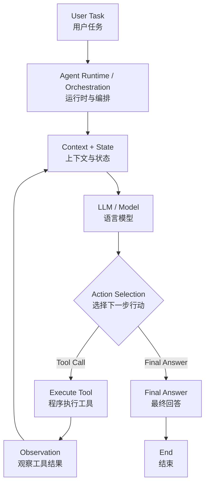

# Agent Architecture Map

## 1. 研究目标

研究主流 Agent 系统的通用架构、运行机制、框架源码和企业工程实践。

最终目标是理解 Agent 的核心功能，阅读关键源码，独立实现简化版本，并将知识应用于真实项目。

## 2. 通用架构（第一版）

下面使用 Mermaid 绘制流程图。GitHub 会将它渲染为图形，而不是普通代码块。

这是一张用于学习的通用抽象图，不代表所有 Agent 框架都采用完全相同的内部实现。

核心过程：

用户提出目标
→ Agent Runtime 组织执行
→ 模型根据上下文作出决策
→ 程序执行工具调用
→ 工具结果返回上下文
→ 模型继续执行或输出最终结果。

## 3. 核心功能模块

### 基础运行机制

- Model：模型调用
- Prompt / Instructions：任务指令
- Context：模型当前可使用的信息
- Agent Loop：模型决策与工具执行的循环
- Tool：可供 Agent 调用的外部能力
- Tool Calling：模型提出工具调用请求，程序执行并返回结果

### 状态与任务组织

- State：当前运行状态与中间数据
- Memory：信息的保留与检索机制
- Planning：任务规划
- Workflow：预先定义的执行流程
- Orchestration：执行步骤和组件的协调
- Handoff：执行控制权交接
- Multi-Agent：多个 Agent 协作

### 生产环境能力

- Human-in-the-loop：人在关键步骤参与审批或决策
- Guardrails：输入、输出和执行约束
- Persistence：状态持久化
- Checkpoint：保存运行状态快照，用于恢复或继续执行
- Observability：运行过程的可观测性
- Tracing：记录和追踪执行过程
- Evaluation：评估任务效果与可靠性
- Security：身份、权限和执行安全
- Deployment：应用部署

以上概念相互关联，但不能简单视为同义词。后续需要结合源码和实验逐个研究。

## 4. 主研究框架

### LangGraph

研究深度：架构与关键源码。

研究重点：

- Graph、Node、Edge
- State
- Graph execution / Runtime
- Checkpoint
- Persistence
- Interrupt 与恢复
- Streaming
- Human-in-the-loop
- Durable execution

研究方法：

官方文档
→ 最小示例
→ 定位 API
→ 追踪源码调用链
→ 绘制执行流程
→ 自己实现简化版本。

### OpenAI Agents SDK

研究深度：架构与核心实现。

研究重点：

- Agent
- Runner
- Tools
- Handoff
- Agent as tool
- Sessions
- Guardrails
- Human-in-the-loop
- Tracing
- Multi-Agent orchestration

研究方法：

官方文档
→ 最小示例
→ 运行实验
→ 定位核心源码
→ 与 LangGraph 对比
→ 整理架构说明书。

### 其他框架

LlamaIndex、Microsoft Agent Framework、CrewAI 等用于必要的架构对照。

不要求在第一个月内对所有框架进行源码级研究。

## 5. 源码研究方法

每个核心模块采用统一流程：

1. 明确功能与待解决的问题。
2. 阅读官方文档。
3. 运行最小示例。
4. 定位公开 API。
5. 查找核心源码。
6. 追踪调用链和数据流。
7. 绘制执行流程。
8. 自己实现简化版本。
9. 记录实验结果和异常情况。
10. 整理成知识库说明书。

## 6. 知识库编写原则

每个核心模块尽可能包含：

1. 一句话定义
2. 解决的问题
3. 在整体架构中的位置
4. 最小执行流程
5. 最小代码示例
6. LangGraph 的实现方式
7. OpenAI Agents SDK 的实现方式
8. 源码文件与关键调用链
9. 企业生产环境中的问题
10. 自己的理解
11. 实验与项目中的应用
12. 参考资料与待研究问题

## 7. 当前待研究问题

- Agent 与普通 LLM 调用有什么区别？
- Agent 与 Workflow 的关系是什么？
- 模型如何请求工具调用？
- 程序如何执行工具并返回结果？
- Context、State、Memory 有什么区别？
- Runtime 如何控制任务继续或结束？
- Checkpoint 与长期记忆有什么区别？
- 如何观察和评估 Agent 的运行结果？
- 多个 Agent 应该如何共享信息、协调任务和互相检查？

## 8. 学习原则

先打通功能，再深入原理。

先运行，再修改；先观察，再读源码；最后通过独立解释和简化实现验证理解。

知识库需要随着代码实验、源码研究和真实项目持续更新。